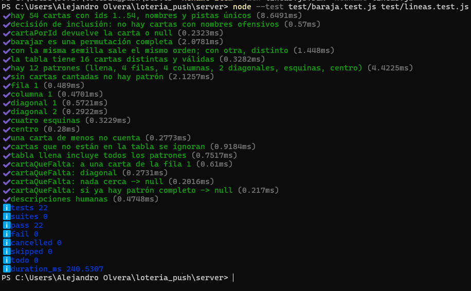
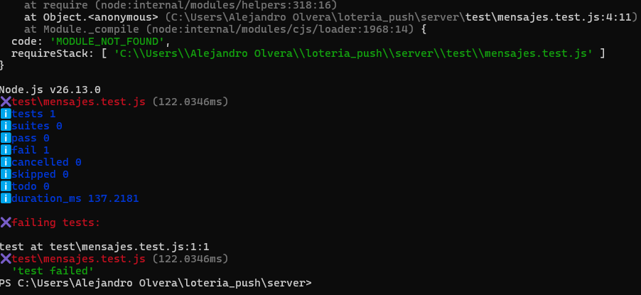
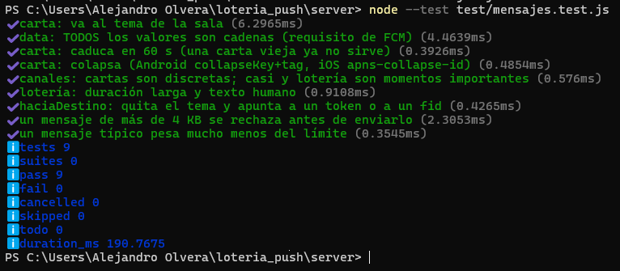
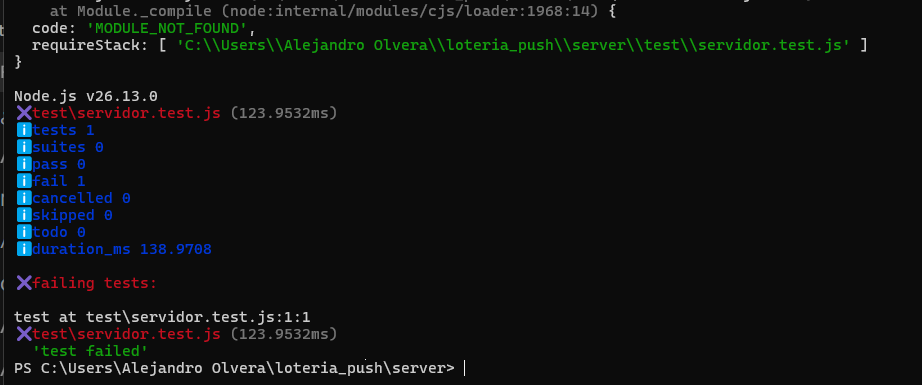
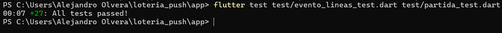
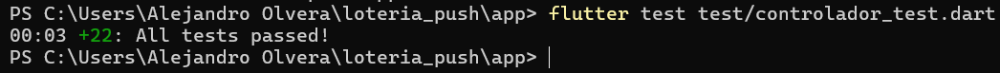
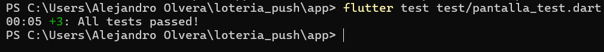
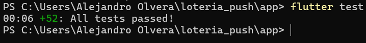
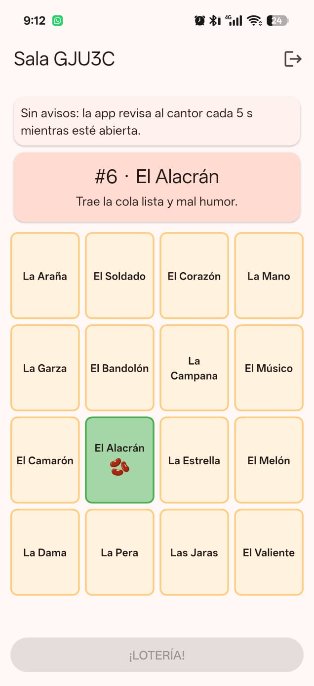

# Lotería Push

Lotería multijugador en **Flutter** donde un **cantor en la nube** (servidor Node) canta las cartas por **notificación push** con Firebase Cloud Messaging (FCM). El juego es el pretexto para aprender notificaciones push bien hechas: permiso en contexto, mensajes de datos, segundo plano, colapso de avisos, higiene de tokens, seguridad y pruebas con **TDD**.

José Alejandro Olvera Lugo
GTID244

---

# Evidencia de TDD

Cada ronda sigue el ciclo **ROJO → VERDE**:

# Parte A. Servidor (Node)

## Ronda 2 · La baraja y las líneas ganadoras (`baraja.test.js`, `lineas.test.js`)

54 cartas únicas, el mazo barajado con semilla, la tabla de 16 cartas, los 12 patrones ganadores y el cálculo de "a qué carta le falta".

**Rojo**

**Verde** (22 pruebas: 6 + 16)

## Ronda 3 · Armar mensajes push correctos (`mensajes.test.js`)

Mensaje de carta al tema de la sala, `data` con todos los valores como cadenas, caducidad de 60 s, colapso en Android e iOS, canales por tipo de aviso y límite de 4 KB.

**Rojo**

**Verde** (9 pruebas)

## Ronda 4 · La sala: reglas, autorización y trampas (`sala.test.js`)

Unirse con nombres válidos, cantar en el orden del mazo secreto, freno de cantos muy rápidos, reclamar la lotería (el servidor valida), el aviso de "¡casi!" una sola vez por jugador y autorización por clave.

**Rojo**

**Verde** (18 pruebas)

## Ronda 5 · El servidor HTTP y el envío seguro (`servidor.test.js`)

Flujo completo (crear sala, unirse, cantar, ver el push), clave del cantor, freno 429, estado por `desde`, fallos de FCM sin romper el estado, token muerto eliminado, destino por token o por FID, entradas malas y errores internos sin filtrar detalles.

**Rojo**

**Verde** (12 pruebas)

## Todas las pruebas del servidor

# Parte B. App (Flutter)

## Ronda 6 · Parsear eventos y mantener la partida (`evento_lineas_test.dart`, `partida_test.dart`)

Parsear lo que llega con desconfianza y mantener la partida de forma idempotente y consciente de huecos.

**Rojo**

**Verde** (27 pruebas)

## Ronda 7 · Puertos, doble de pruebas y controlador (`controlador_test.dart`)

La app habla con el mundo por dos puertas (push y API) y se prueba con dobles de prueba (`falsos.dart`) sin Firebase ni red.

**Rojo**

**Verde** (22 pruebas)

## Ronda 9 · Pantallas, ViewModels y arranque (`pantalla_test.dart`)

La pantalla muestra la sala y el aviso de "sin push", el botón **¡LOTERÍA!** está apagado hasta completar un patrón y, cuando otro jugador gana, aparece el mensaje y el botón se apaga.

**Rojo**

**Verde** (3 pruebas)

## Todas las pruebas de la app

# La app funcionando en el teléfono

Probada en un dispositivo Android real, con el servidor corriendo en la computadora y push real a través de Firebase.

