<<<<<<< HEAD
# Lotería Push 🐓

Notificaciones push (Firebase Cloud Messaging) en Flutter, con un cantor de Lotería en un servidor Node.
Manual de Desarrollo Móvil Integral, UTNG.

```
loteria_push/
  server/   el cantor (Node, sin dependencias para correr las pruebas)
  app/      la app Flutter
```

## 1. Servidor (necesita Node 20 o más nuevo)

```bash
cd server
npm test          # 61 pruebas, deben pasar todas
npm start         # cantor en http://localhost:8080 con push SIMULADO (se imprime en consola)
```

No necesita Firebase para jugar: cada push que se habría enviado sale en la consola.

## 2. App Flutter (una sola vez)

Desde la carpeta `app/`:

```bash
flutter create . --project-name loteria_push   # genera android/ e ios/ (no pisa lib/ ni pubspec.yaml)
dart tool/configurar.dart                      # permisos, canal y desugaring de Android
flutter pub get
flutter test                                   # las pruebas NO necesitan Firebase
```

> Si `dart tool/configurar.dart` falla, los cambios a mano están en la Ronda 1 del manual
> (AndroidManifest.xml y android/app/build.gradle.kts). Borra también `test/widget_test.dart`
> si `flutter create` lo generó.

## 3. Firebase (solo para correr la app, no para las pruebas)

```bash
npm install -g firebase-tools && firebase login
dart pub global activate flutterfire_cli
flutterfire configure        # genera lib/firebase_options.dart
flutter run --dart-define=SERVIDOR=http://10.0.2.2:8080
```

- Sin `lib/firebase_options.dart` la app no compila (`flutter analyze` marcará ese error), pero `flutter test` sí corre.
- `10.0.2.2` es el "localhost" del emulador Android. En un teléfono real usa la IP de tu compu (ej. `http://192.168.1.50:8080`).
- Para push de verdad: `npm install firebase-admin`, `GOOGLE_APPLICATION_CREDENTIALS=/ruta/cuenta.json`
  y `FCM_REAL=1 FCM_DRY_RUN=1 npm start` (valida sin entregar). Quita `FCM_DRY_RUN` para entregar.
  El JSON de la cuenta de servicio **nunca** va dentro de la app ni del repositorio.

## Cambios respecto al manual

- `app/test/pantalla_test.dart`: la función `abrir` fija una pantalla de prueba de 400x1000. Con los 800x600 por
  defecto, el `ListView` no construye el botón ni el aviso de ganador (quedan muy abajo) y las pruebas no los encuentran.
- `app/tool/configurar.dart`: script extra para aplicar la configuración de Android.

Ver `GUIA_PRUEBAS_Y_CAPTURAS.md` para los comandos de pruebas y capturas.

## 4. Generar el APK para tu celular

1. **Servidor en tu compu** (el celular se conecta a él por wifi): `cd server && npm start`.
2. Averigua la IP de tu compu en la misma red wifi que el celular (`ipconfig` en Windows, busca "Dirección IPv4", ej. `192.168.1.50`).
   Permite el puerto 8080 en el firewall de Windows si te lo pregunta.
3. Compila el APK con esa IP metida (dentro de `app/`):

```bash
flutter build apk --release --dart-define=SERVIDOR=http://192.168.1.50:8080
```

4. El archivo queda en `app/build/app/outputs/flutter-apk/app-release.apk`. Pásalo al celular (cable, Drive o WhatsApp),
   ábrelo y acepta "instalar apps de origen desconocido". Con el cable y la depuración USB activada también puedes usar
   `flutter install` o `flutter run --release`.

Notas:
- `10.0.2.2` solo sirve en el emulador; en el celular siempre usa la IP de tu compu. Si cambias de red, la IP cambia y hay que recompilar.
- Con el servidor en modo simulado (`npm start` normal) no salen push reales. Para probar la app en el celular sin Firebase de servidor,
  responde "Mejor no" a los avisos: la app revisa al cantor cada 5 s y el juego funciona.
- Para push de verdad: `npm install firebase-admin` en `server/`, descarga la cuenta de servicio (Firebase, Configuración, Cuentas de servicio)
  y en PowerShell: `$env:GOOGLE_APPLICATION_CREDENTIALS="C:\ruta\cuenta.json"; $env:FCM_REAL="1"; npm start`.
  Ese JSON nunca va dentro de la app ni en GitHub.
=======
# Lotería Push

Lotería multijugador en **Flutter** donde un **cantor en la nube** (servidor Node) canta las cartas por **notificación push** con Firebase Cloud Messaging (FCM). El juego es el pretexto para aprender notificaciones push bien hechas: permiso en contexto, mensajes de datos, segundo plano, colapso de avisos, higiene de tokens, seguridad y pruebas con **TDD**.

José Alejandro Olvera Lugo
GTID244

---

# Evidencia de TDD

Cada ronda sigue el ciclo **ROJO → VERDE**:

# Parte A. Servidor (Node)

## Ronda 2 · La baraja y las líneas ganadoras (`baraja.test.js`, `lineas.test.js`)

54 cartas únicas, el mazo barajado con semilla, la tabla de 16 cartas, los 12 patrones ganadores y el cálculo de "a qué carta le falta".

**Rojo**

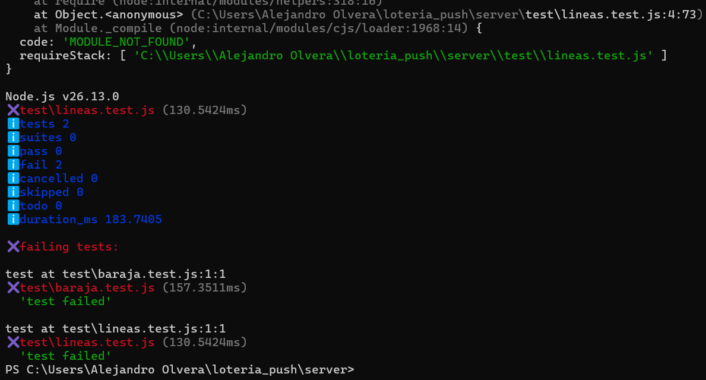

**Verde** (22 pruebas: 6 + 16)


## Ronda 3 · Armar mensajes push correctos (`mensajes.test.js`)

Mensaje de carta al tema de la sala, `data` con todos los valores como cadenas, caducidad de 60 s, colapso en Android e iOS, canales por tipo de aviso y límite de 4 KB.

**Rojo**


**Verde** (9 pruebas)


## Ronda 4 · La sala: reglas, autorización y trampas (`sala.test.js`)

Unirse con nombres válidos, cantar en el orden del mazo secreto, freno de cantos muy rápidos, reclamar la lotería (el servidor valida), el aviso de "¡casi!" una sola vez por jugador y autorización por clave.

**Rojo**

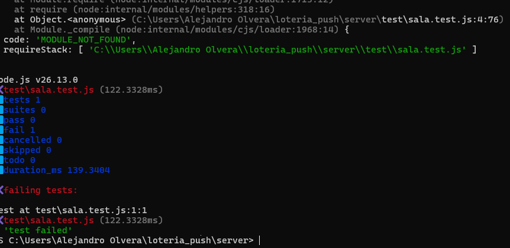

**Verde** (18 pruebas)

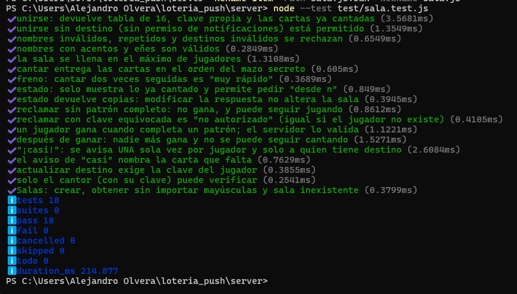

## Ronda 5 · El servidor HTTP y el envío seguro (`servidor.test.js`)

Flujo completo (crear sala, unirse, cantar, ver el push), clave del cantor, freno 429, estado por `desde`, fallos de FCM sin romper el estado, token muerto eliminado, destino por token o por FID, entradas malas y errores internos sin filtrar detalles.

**Rojo**


**Verde** (12 pruebas)

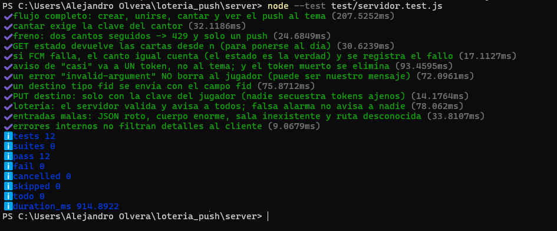

## Todas las pruebas del servidor

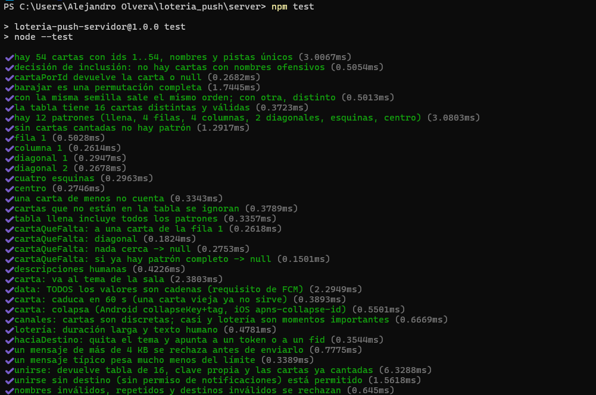

# Parte B. App (Flutter)

## Ronda 6 · Parsear eventos y mantener la partida (`evento_lineas_test.dart`, `partida_test.dart`)

Parsear lo que llega con desconfianza y mantener la partida de forma idempotente y consciente de huecos.

**Rojo**

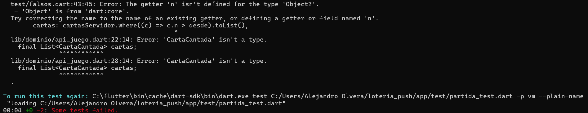

**Verde** (27 pruebas)


## Ronda 7 · Puertos, doble de pruebas y controlador (`controlador_test.dart`)

La app habla con el mundo por dos puertas (push y API) y se prueba con dobles de prueba (`falsos.dart`) sin Firebase ni red.

**Rojo**

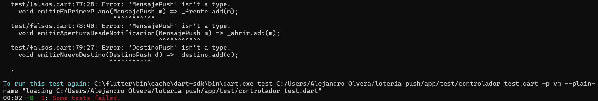

**Verde** (22 pruebas)


## Ronda 9 · Pantallas, ViewModels y arranque (`pantalla_test.dart`)

La pantalla muestra la sala y el aviso de "sin push", el botón **¡LOTERÍA!** está apagado hasta completar un patrón y, cuando otro jugador gana, aparece el mensaje y el botón se apaga.

**Rojo**

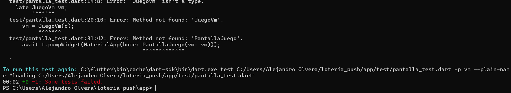

**Verde** (3 pruebas)


## Todas las pruebas de la app


# La app funcionando en el teléfono

Probada en un dispositivo Android real, con el servidor corriendo en la computadora y push real a través de Firebase.

### 1. Pantalla inicial

Sin ningún diálogo de permiso al abrir. Se puede unir a una sala o crear una como cantor.

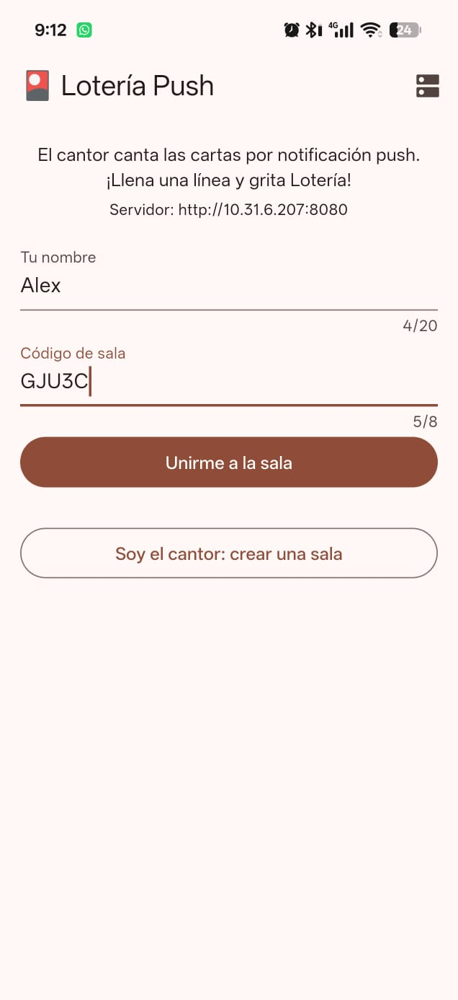

### 2. Pantalla del cantor

El código de la sala para compartir, el botón para cantar la siguiente carta y el interruptor para cantar automáticamente cada 6 segundos.


### 3. Permiso en contexto

Antes del diálogo del sistema, la app explica para qué sirven los avisos (cuando se canta una carta y cuando estás a UNA de ganar) y deja elegir "Mejor no".

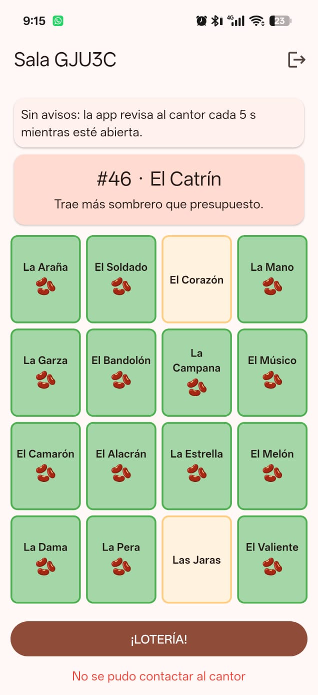

### 4. La sala

La tabla de 16 cartas, "Esperando la primera carta..." y el botón **¡LOTERÍA!** apagado.

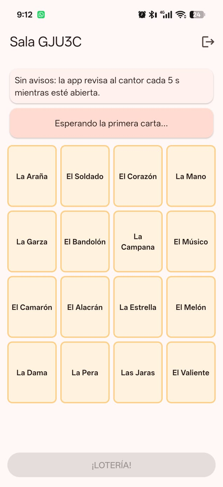

### 5. Carta cantada

Llegó la carta **#2 · El Elote**: se muestra arriba con su pista y, como está en la tabla, la casilla queda marcada con un frijol.


### 6 y 7. Notificaciones push de las cartas

Las cartas llegan como notificación push a la bandeja del sistema (aquí "El Cotorro" y "El Árbol", con su pista).

 

---
>>>>>>> af4c78a7081b4bf1501eb03c912e110d98067eab
